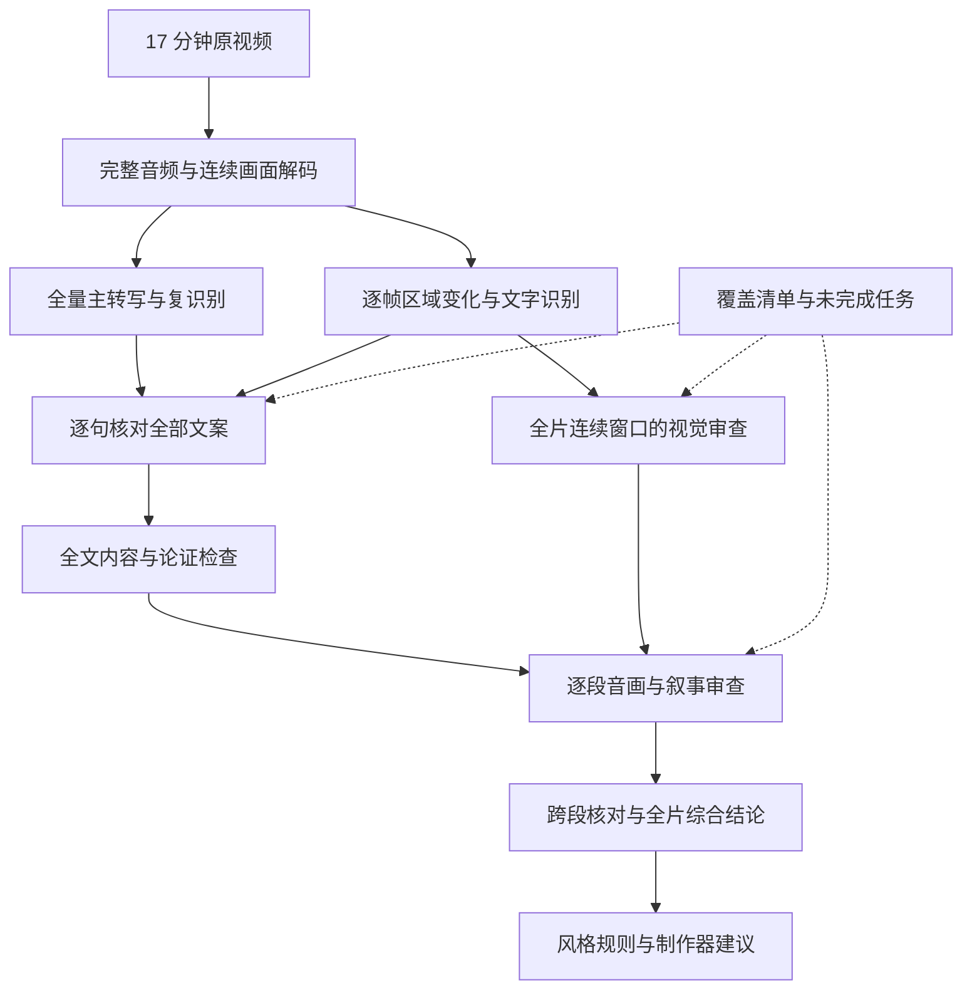

# BV1AV411V7SJ 全量文案检查与全片审查设计

更新日期：2026-10-26。本文包含本地音视频分析框架的搜索调研、推荐组合与实战实施方案。

实施状态：本文保留调研与目标设计；当前可运行版本、两部视频的实际覆盖及导演稿见 [实跑案例](README.md)。首版采用 Java 调度与 Python faster-whisper / PyAV / RapidOCR worker；本文提到的其他框架不代表均已集成，完整听音校准仍待完成。

## 1. 目标与当前状态

先取得全部视频文案并逐句检查，再结合全片画面和声音逐段审查，最后提炼制作器能够复用的创作方法。最终成果需要解释完整内容、数学论证、叙事结构、音画配合和具体改进方式。

此前完成的媒体探测和 12 处画面抽查，只能说明文件信息与局部外观。原方案据此提出的主题、知识链和叙事结构假设撤回，等全文检查与全片审查完成后重新建立。当前尚未取得完整转写，也未完成全文检查或全片审查；本文是修订后的设计与选型结论。

原始输入：

```text
Z:\workspace\bilibili-download-skill\downloads\BV1AV411V7SJ\此视频的所有收益均捐给我用来买拼图 [BV1AV411V7SJ].mkv
```

已探测到的事实：

| 项目 | 结果 |
| --- | --- |
| 素材标识 / 大小 | `BV1AV411V7SJ`；76,757,647 字节 |
| SHA-256 | `c0ee37461026f0c23254c57b85f2858592f03a2fa89db75e81102ad5102eec3d` |
| 容器时长 | 1,023.444 秒，即 17:03.444 |
| 主视频 | stream 0，HEVC，1920 × 1080，报告帧率 `30/1`，轨标签时长 17:03.366 |
| 音频 | stream 1，AAC，44,100 Hz，双声道，轨标签时长 17:03.444 |
| 封面 | stream 2，MJPEG，`attached_pic=1`，排除在正片分析之外 |
| 字幕 / 章节 | 没有独立字幕轨、容器章节或同目录 SRT/ASS/VTT；画面抽查可见烧录字幕 |

本片有绘图软件画布、聊天区、虚拟形象和字幕等多个区域。它们仅用于规划识别方法，不能替代对实际讲述内容的检查。

## 2. 搜索后的框架选型

调研优先阅读维护者仓库、官方 API 文档及模型使用说明。以下能力是框架提供的能力，针对本片的识别质量、耗时和部署可行性仍需实测。

### 2.1 音频：识别、对齐和声音特征

| 框架 | 官方资料确认的能力 | 采用方式与边界 |
| --- | --- | --- |
| [faster-whisper](https://github.com/SYSTRAN/faster-whisper) | 基于 CTranslate2 的 Whisper 推理，支持 CPU/GPU、量化、词时间戳、Silero VAD | 全片主转写引擎，优先评估多语言 `large-v3`；保存原始分段及词时间戳。实际精度与运行配置需要本片校准 |
| [FunASR](https://github.com/modelscope/FunASR) | ASR、VAD、标点等本地管线；模型及路径决定时间戳等输出 | 第二套全片中文转写，用 Paraformer 中文管线比较识别分歧。不同模型的字段与时间粒度需分别验证，见 [Python API](https://github.com/modelscope/FunASR/blob/main/docs/python_api.md) |
| [WhisperX](https://github.com/m-bain/whisperX) | 在转写上增加语言相关的强制对齐，也可接说话人分离 | 对修正后的文本做更细时间对齐；中文需验证相应对齐模型，词典外的数字、符号可能无有效时间。对齐不会证明词句正确 |
| [sherpa-onnx](https://github.com/k2-fsa/sherpa-onnx/blob/master/java-api-examples/README.md) | 提供 Java 离线 ASR 与 VAD 示例，可使用 SenseVoice、Paraformer 等模型 | Java 直接部署的备选。时间戳按模型验证；官方 [Paraformer 模型说明](https://k2-fsa.github.io/sherpa/onnx/pretrained_models/offline-paraformer/paraformer-models.html) 包含不支持时间戳的模型 |
| [librosa](https://librosa.org/doc/0.11.0/feature.html) | RMS 能量、频谱等音频特征提取 | 辅助描述音量变化、停顿和声音密度；语速结合已校对文本计算。情绪、音乐性质等语义判断还需要相应声音证据 |

采用组合：**faster-whisper 全量主转写 + FunASR 全量复识别比对；需要细时间戳时加入 WhisperX；librosa 提供声学量化。** 两套文本一致仍可能同时出错，必须结合音频、字幕和上下文逐句检查。

本机 FFmpeg 的 Whisper 滤镜已确认可用，可作为部署备选。它输出转写，后续仍需完成识别冲突处理、文案检查及审查。

### 2.2 视频：解码、变化检测、文字与语义

| 框架 | 官方资料确认的能力 | 采用方式与边界 |
| --- | --- | --- |
| FFmpeg / [JavaCV](https://github.com/bytedeco/javacv) | JavaCV 通过 JavaCPP 封装 FFmpeg、OpenCV 等本地库 | FFprobe 探测轨道，FFmpeg 导出完整音频；JavaCV 接入 Java 内连续解码及图像处理。保留源时间戳，验证 HEVC、轨道选择和本地库部署 |
| [OpenCV Java API](https://docs.opencv.org/4.x/javadoc/org/opencv/video/Video.html) | 图像处理、运动估计和配准相关能力 | 对每个解码帧处理画布、字幕等区域，检测书写、擦除、移动和布局变化；具体语义另行逐段理解 |
| [PySceneDetect](https://www.scenedetect.com/docs/latest/api/detectors.html) | ContentDetector、AdaptiveDetector 等镜头切换检测 | 生成切换候选与统计；连续画布讲解还需区域变化和文案边界共同分段 |
| [PaddleOCR](https://github.com/PaddlePaddle/PaddleOCR) | 本地文字识别，另有 [公式识别模块](https://github.com/PaddlePaddle/PaddleOCR/blob/main/docs/version3.x/module_usage/formula_recognition.en.md) | 提取烧录字幕和画面文字，数学裁图独立识别。手写符号、箭头和几何关系保留原图及不确定性，识别结果需核对 |
| [Qwen3-VL](https://github.com/QwenLM/Qwen3-VL) + [Transformers](https://huggingface.co/docs/transformers/en/tasks/video_text_to_text) | 本地视觉语言模型及视频输入处理，可配置采样帧率或帧数 | 可选的逐段视觉语义组件，先评估小模型。处理器会选择输入帧，必须记录采样范围；传入视频文件不表示逐帧理解了全部内容 |

采用组合：**JavaCV/FFmpeg + OpenCV 连续处理全片；PaddleOCR 提取所有文字变化状态；PySceneDetect 辅助分镜；GPT 逐段审查音画证据。** 本地 Qwen3-VL 可替换部分视觉语义工作，是否启用由显存、识别质量和时延实测决定，不作为首次转写的前置依赖。

通用框架分别提供识别、对齐、图像处理和模型推理能力；数学内容审查和创作方法归纳由本项目组织，并单独验收。

### 2.3 当前机器与部署

已检查到本机有 NVIDIA RTX 3080（10,240 MiB 显存）、Ryzen 9 9950X3D（16 核 / 32 线程）和约 128 GB 内存。可以安排本地推理试跑，但模型、批量大小和 CUDA 组合尚未验证。

- GPU 推理任务先串行调度，避免 ASR、OCR 和视觉模型同时占满显存。记录实测峰值显存和总耗时，配置模型、批量、精度及图片尺寸。
- 已发现缓存中的 Whisper `.pt` 文件及 faster-whisper 的 base 模型目录；完整性仍需加载验证。PyTorch `.pt`、CTranslate2 和 whisper.cpp 所需格式不同，不能只改路径混用。
- 检查的默认 Python 3.13 中有 `cv2`，未发现本方案所需的主要 ASR/OCR 包；其他环境未完整核验。推理组件使用独立环境，按官方支持范围固定 Python、CUDA、依赖和模型版本。
- Java 负责业务编排、覆盖核对、审查记录、规则校验和报告。Python 组件通过独立进程接收任务文件、输出 JSON/JSONL；保留现有两个 Maven 子项目。
- sherpa-onnx 可作为 Java 直接 ASR 实现，与相同测试集比较后决定是否替换组件。分别记录工具代码和权重授权；FunASR 官方明确两者可能采用不同条款。

## 3. 全量处理与审查流程



短样本只验证工具和参数。正式分析覆盖源起点到片尾，全部音频、全部文案单元和全部视频时间窗口进入相应流程。

## 4. 第一步：取得全部文案并逐句核对

### 4.1 全量识别和对齐

1. 提取完整主音轨，保留原双声道用于声音审查，另生成适合 ASR 的音频；记录重采样、切片和源时间映射。
2. faster-whisper 与 FunASR 分别处理整条音轨。长音频按有重叠的连续区间调度，回填源时间并去重；每个区间都有输入、结果或失败状态。
3. VAD 提供语音候选及分段依据。ASR 空输出或 VAD 未检出语音不能直接记成静音：与另一识别结果、声学信号和字幕变化交叉检查，疑似漏识别区间关闭 VAD 或扩大上下文重跑。
4. 全部烧录字幕变化状态经 OCR 提取，按时间合并；说话文本、字幕文本和画布文字分开保存。字幕与音频可能有不同内容和偏移，不能互相覆盖原始结果。
5. 两套 ASR 与字幕全文对齐，生成逐句差异清单。标点、数字规范化仅用于比较，保留原始文本，不能抹掉否定词、条件或公式差异。
6. 核对数学名词、英文缩写、数字序列、条件句和所有识别分歧，必要时回听音频、查看连续画面或再识别。没有把握的内容保留 `[听不清]` 及时间范围，不补造文案。

### 4.2 全部文案的检查记录

先交付带稳定句子 ID、源时间戳和校对依据的完整逐字稿。保留原始语气、重复、插话和互动；整理后的讲解稿另存，不能用整理稿冒充原话。

每个句子都要记录：

- 原始识别、校对文本、原字幕及差异、校对状态和依据。
- 上下文含义、承担的讲解或互动作用，以及对前文和画面的依赖。
- 定义、前提、事实主张、推导或结论；不适用的项目明确标注。
- 用词、语义、指代、逻辑及数学疑点，以及相关上下文和复核任务。

GPT 按连续段落阅读全部文案，每次携带前后文及句子 ID，返回本批所有句子的检查结果。应用核对 ID 是否全部返回、顺序是否保留、有无遗漏。全文检查完成后再建立主题与论证链，概览摘要只作导航，不能代替逐句检查。

## 5. 第二步：连续处理全片并逐段审查

### 5.1 连续画面处理

- 从主视频首帧处理到末帧，记录解码数量、源 PTS 区间、失败及不连续情况。排除封面轨，不以时长乘以帧率代替实测帧数，不把解码成功等同于理解正确。
- 每个解码帧进入区域变化检测：画布、字幕、聊天和虚拟形象分别建模，区域随布局更新，记录缩放、平移、遮挡和重新定位。
- 连续检测字幕变化，为每个候选文字状态保留起止时间、代表帧和 OCR。渐变字幕、短暂文本、识别冲突及边界需回查相邻源帧；固定间隔抽图不能保证文字完整。
- 画布按书写、擦除、换图、缩放和稳定状态建立事件序列。配准前后保留原图，去重不能删除新字、数字变化或条件改写。
- 全部帧流式分析，只保存必要的图像、事件序列和复核片段，避免长期保存全片无压缩图片；需要时按实际 PTS 从原视频重取。

### 5.2 全片视频内容的逐段审查

以连续时间窗口覆盖全片，例如 20–30 秒一个基础窗口，边界加前后文；快速板书、切换及公式推导细分为更短窗口。窗口是任务单位，镜头、视觉事件和语义段各有结构。

每个窗口都有审查记录，包括静音演示、无字幕画面和片尾：

| 维度 | 必须检查的内容 |
| --- | --- |
| 画面内容 | 对象、文字、公式及操作是什么，状态发生什么变化 |
| 分镜与表达 | 连续镜头、画布事件、视口移动、转场和视觉强调各有什么作用 |
| 音画对应 | 每句讲解对应什么画面，有无文字错误、指代不明、步骤缺失或不同步 |
| 可理解性 | 字号、留屏、遮挡、信息密度和变化速度如何影响理解，依据是什么 |
| 声音表现 | 全段语音、停顿、音量及其他可听事件如何配合表达，统计和主观判断分开 |
| 问题与建议 | 问题时间范围、来源、影响、具体修改动作及可验证的预期效果 |

模型收到当前窗口的完整文案、画面序列、OCR、事件及声音依据。画面按事件和持续时间组织，重要操作保留前、中、后状态，快速变化时补帧或缩短窗口。记录实际送入模型的帧、时间间隔及未清晰观察的区域。

模型可能漏看选择帧之间的细节。涉及动作顺序、短暂符号、逐笔推导的主张，证据不足时补看原片段或更密帧序列，不能把每个窗口都请求过模型写成每一帧都被语义审查过。声音结论必须来自声音分析或听辨，不能让只收到文本和图像的模型声称听到了音色或音乐。

## 6. 第三步：全片内容、论证与创作方法审查

全部文案检查和逐段视听审查之后，按原始顺序复核：

1. **主题与完整内容**：到底提出什么问题，解释哪些概念，提供什么答案，各内容段的位置和作用是什么。
2. **数学与逻辑**：定义、前提、例子、推导和结论如何连接，有无遗漏条件、跳步、以例代证或前后矛盾。区分原作者主张和分析器解释，必要时用权威资料与可复现计算交叉验证。
3. **叙事与文案**：开场、铺垫、转折、解释、互动和收束如何形成整体，指代与知识依赖是否清楚，重复和枝节承担什么作用。
4. **分镜与视听**：画面、字幕、板书、配音和节奏如何支撑各段目标；其他段落是否已解释当前疑点，避免脱离上下文批评。
5. **风格与可复用方法**：从全片多个段落归纳稳定规则，写出适用条件、来源证据、实现动作和验证方式；局部手法限定适用范围。
6. **改进方案**：按问题给出重写文案、补充论证、调整画面操作、留屏、字幕或停顿的具体建议；测量值和建议值分开。

主题、论证和制作策略从上述记录推导，不预设现成叙事结构。数学判定需要原句、上下文及图像，输入仍有歧义时标为待核验，不能用模型自信程度替代证明。

## 7. 产物与覆盖验收

| 产物 | 最少内容 |
| --- | --- |
| `transcript-raw/` | 两套完整 ASR 原始结果、时间粒度、参数和模型版本 |
| `transcript.md` / `transcript.json` | 全部校对文案、句子 ID、时间、校对依据和听不清区间；整理稿另存 |
| `screen-text.jsonl` | 全部识别文字状态、区域、时间、裁图引用及识别冲突 |
| `script-review.json` | 每个句子的含义、作用、主张、疑点、上下文及检查状态 |
| `timeline.json` / `segment-reviews.json` | 全片镜头、画面事件、语义段、逐段音画审查及证据 |
| `report.md` | 完整主题与内容、论证检查、叙事和视听审查、问题及具体优化建议 |
| `style-profile.json` / `maker-brief.json` | 来源可追溯的风格规则、新主题制作步骤、参数与必要能力；格式为版本化草案 |
| `coverage.json` / `manifest.json` | 分阶段覆盖、缺失/失败、未确认证据、人工复核状态、版本、预算及恢复信息 |

覆盖分开计算，不用一个百分比概括：

| 层次 | 验收方法 |
| --- | --- |
| 音视频解码 | 实际处理源起点到各轨末尾；列出 PTS 缺口和解码错误，音视频尾部时长差如实记录 |
| 转写与文字提取 | 每个音频区间及检测到的字幕状态都有结果；语音/静音分类、空输出和识别分歧有复核依据 |
| 全文检查 | 所有句子 ID 都有逐句检查结果，关键主张及条件可定位，未确认原文明示 |
| 视频语义审查 | 全片连续窗口逐一有结果，记录视觉输入和局限，无未说明的覆盖空白 |
| 人工复核 | 单独记录实际回听/回看范围、问题及结论，未执行就标为未执行 |

形式上覆盖全时间轴不保证识别无误。报告同时列出覆盖情况、质量问题与剩余不确定性。确认发现的内容错误是审查结果；因未处理或证据不足而无法审查的范围是未完成工作，整体标记 `partial`。

采样校对可用于比较引擎字符错误率、调节阈值和时间偏移，指标只代表对应标注样本。不能据此声明整片文案正确、全部论证已审查或视频已经人工看完。

## 8. 工程实现与执行顺序

包前缀为 `com.xenoamess.vivhite_video_framework.analyzer`，分为 `media`、`transcript`、`vision`、`review`、`report` 和 `application`。推理组件用文件协议隔离，数据模型及最终校验由 Java 掌握。

- 时间使用源媒体毫秒区间，同时保留原始 PTS/time base；片段结果加回源偏移，重叠去重，禁止负时间及无依据的精确时间。
- 结论、问题及建议引用句子/片段/证据 ID；跨段结论保留全部相关上下文。应用校验引用、结构和任务覆盖，模型缺项时继续处理。
- 内容较长时按任务清单分批交给 GPT、逐项合并；综合阶段仍可回查原文和原片段。接口能力参考 [图像输入](https://developers.openai.com/api/docs/guides/images-vision?api-mode=responses) 与 [Structured Outputs](https://developers.openai.com/api/docs/guides/structured-outputs?api-mode=responses)。
- 预算根据全片任务清单估计，限制单次输入、并发和总用量；不足时保存断点及未完成范围，不删除后半段任务来满足限额。记录实际用量及可配置价格，不预先承诺费用。
- 缓存键包含素材指纹、轨道、工具/模型、预处理、参数、提示词和格式版本。仅复用校验通过的结果；换模型或修正文案时使依赖任务失效。
- 工作目录位于仓库外，原视频不变。密钥、模型、音频、全量帧和运行日志不加入 Git；外部进程提供中文路径支持、超时、取消、退出码及子进程清理。

| 阶段 | 工作与交付 | 完成标准 |
| --- | --- | --- |
| E0：工具就绪 | 验证 ASR、复识别、OCR、解码及 Java 接入，用短样本校准并锁环境 | 工具/模型清单、可用配置及部署记录齐备；只表示技术准备完成 |
| E1：全量文案 | 全部 17:03 音频和全片字幕，两套识别、全文及差异记录 | 交付全部文案和未确认区间，不能只交付开头样本 |
| E2：全文检查 | 原顺序逐句检查，建立定义、前提及论证关系 | 每句有记录，关键主张可定位，缺失及疑点有清单 |
| E3：全片审查 | 连续处理完整画面与音频，全部窗口检查内容、分镜、声音和音画关系 | 逐段记录覆盖首尾，证据不足处已补查或明确未完成 |
| E4：综合与制作建议 | 跨段复核主题、论证、叙事及风格，形成改进与新主题制作方法 | 报告与原文、视听证据和制作建议对应，运行状态准确 |

下一项实际内容工作是 E1 的全量转写与文案校对。此前局部画面观察不作为 E1–E4 已完成的依据。本轮完成框架调研与设计修订，没有安装推理环境，也没有执行全量识别或宣称完成视频审查。
