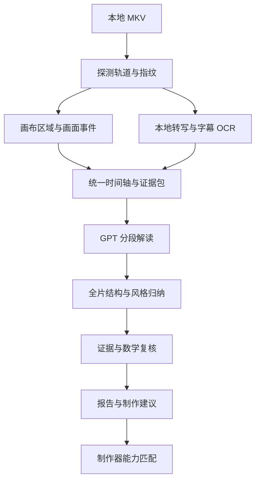

# BV1AV411V7SJ 视频解读方案

设计日期：2026-10-26。本文用于指导 `video-analyzer` 的首次实战实现。

## 1. 本次要交付什么

围绕这一个视频跑通“本地提取证据 → GPT 分段理解 → 全片归纳 → 制作器可复用方案”。最终需要回答：视频讲了什么数学问题，如何组织讲解，每一步用什么画面配合，风格如何形成，以及制作器如何用相同的表达方法讲一个新主题。

本次设计前已完成文件探测、SHA-256 计算和 12 个时间点的画面抽查；尚未完成逐句转写、全片音频听辨、逐镜头标注或 GPT 分析。以下区分实测信息、抽样观察和拟实现方案，不将抽查当作完整解读。

建议首版交付五类结果：

| 产物 | 内容 | 使用者 |
| --- | --- | --- |
| `report.md` | 主题、知识链、叙事结构、创作风格、优缺点、逐条建议和证据链接 | 人 |
| `timeline.json` | 全片的讲解段落、镜头、画面事件、对齐文案及证据引用 | 人及后续工具 |
| `style-profile.json` | 可测量的视觉与节奏特征，以及从素材归纳的表达策略 | 制作器 |
| `maker-brief.json` | 将表达策略转为新主题的制作步骤、参数建议、必要能力和验收条件 | 制作器 |
| `evidence/` 与 `manifest.json` | 原始探测结果、关键帧、转写/OCR、来源、配置、版本、阶段状态及调用用量 | 复核与重跑 |

这些文件格式先在分析器内定义为 `0.1` 草案，实施时补齐 JSON Schema 和示例。制作器尚无对应实现，因此不能把生成 JSON 等同于已经可以自动渲染。

## 2. 这份素材的实际情况

### 2.1 文件与媒体信息

输入文件：

```text
Z:\workspace\bilibili-download-skill\downloads\BV1AV411V7SJ\此视频的所有收益均捐给我用来买拼图 [BV1AV411V7SJ].mkv
```

| 项目 | 实测结果 |
| --- | --- |
| 文件大小 | 76,757,647 字节 |
| SHA-256 | `c0ee37461026f0c23254c57b85f2858592f03a2fa89db75e81102ad5102eec3d` |
| 容器时长 | 1,023.444 秒，即 17:03.444 |
| 主视频 | stream 0，HEVC，1920 × 1080；报告帧率 `30/1`，需解码时间戳进一步确认帧间隔 |
| 主视频轨标签时长 | 17:03.366 |
| 音频 | stream 1，AAC，44,100 Hz，双声道；轨标签时长 17:03.444 |
| 附图 | stream 2，MJPEG，1200 × 750，`attached_pic=1`，是封面 |
| 字幕与章节 | 没有独立字幕轨、容器章节或同目录旁挂 SRT/ASS/VTT |
| 标题/作者元数据 | 标题为文件名中的标题；`ARTIST` 为“白绮Infinity”，属于容器元数据 |
| 来源标识 | `BV1AV411V7SJ`；容器记录的站点链接归一化为 `https://www.bilibili.com/video/BV1AV411V7SJ/` |

实现中必须明确选择主视频轨，排除 `attached_pic=1` 的封面。主视频与音频尾部存在约 78 ms 的时长差，报告应记录真实覆盖范围，不为凑齐容器时长补造最后一帧。

### 2.2 画面抽查得到的设计依据

本次按源时间定位抽帧，检查了 0、30、90、180、300、420、540、660、780、900、990、1020 秒。下表描述的是这些采样点，不代表已经确定的章节边界。

| 采样位置 | 观察 | 对分析方法的影响 |
| --- | --- | --- |
| 00:00、00:30 | 绘图软件内展示实体滑块拼图图片 | 从具体物件和问题进入讲解是待验证的叙事线索 |
| 01:30、03:00 | 白色画布上有手绘格子、状态图，出现 DFS/BFS 字样 | 需要识别手绘过程和知识关系，不能只读字幕 |
| 05:00、07:00 | 画布出现矩形尺寸到 `2×2` 的书写、格子示意 | 需要保留前后状态，跟踪论证中的简化步骤 |
| 09:00 | 烧录字幕出现“有且只有两个等价类” | 等价类是候选知识点，具体对象与条件要查上下文 |
| 11:00、13:00 | 字幕与板书涉及把拼图展开为数字序列、交换位置 | 待核对置换、状态可达性及相关不变量的论证 |
| 15:00、16:30、17:00 | 数字格子、拆开的拼图片段、原始拼图图片重新出现 | 候选结构为“实例 → 抽象 → 推导 → 回到实例” |

跨多个采样点可见：绘图软件界面、右下角虚拟形象、左侧聊天叠层、底部紫色字幕和水印。主要讲解画布会缩放或移动。

据此可以提出“围绕滑块拼图，从算法/状态讨论进入数学解释”的工作假设。标题本身不能说明完整主题；群论、置换、可解性条件之间的准确关系，仍需完整转写和论证复核。当前也不能判断配音语速、背景音乐、真实镜头数量或具体制作软件工程。

## 3. 总体流程与技术落点



以 Java 21 编排本地 CLI，使用 `ProcessBuilder` 调用 FFprobe、FFmpeg 和本地识别工具；分析记录及校验逻辑保留在 Java 中。先以文件目录和阶段清单保存状态，使每一步的结果可检查、可复用。

建议的包内职责如下，均位于 `com.xenoamess.vivhite_video_framework.analyzer` 下；这是拟议划分，当前尚未实现这些类。

| 区域 | 主要职责 |
| --- | --- |
| `application` | `AnalysisPipeline`，协调阶段、预算、恢复和局部重跑 |
| `media` | `FfprobeClient`、`FfmpegClient`、`ExternalProcessRunner`，探测、解码和进程生命周期 |
| `transcript` | `LocalTranscriber`、`SubtitleOcr`，保留原文并对齐识别结果 |
| `timeline` | `LayoutSegmenter`、`VisualEventDetector`、`EvidenceAligner` |
| `gpt` | `GptAnalysisClient`，构造多模态输入、接收结构化结果、记录调用情况 |
| `domain` | 素材、证据、讲解段、画面事件、分析结论及建议的数据模型 |
| `report` | `ReportValidator`、`ReportWriter`、`MakerBriefAssembler` |

外部进程参数逐项传递，覆盖中文、空格、方括号和 Windows 盘符；不拼接 shell 命令。分别处理标准输出与错误输出，提供超时、取消、退出码和子进程清理。处理 `Z:` 映射盘不可见或中途断开的情况，允许用同一内容指纹从其他路径恢复。

## 4. 本地分析：先建立可靠证据

### 4.1 轨道、时间和工作目录

- 保存 FFprobe 原始 JSON 和规范化的 `source.json`；记录实际使用的轨道与工具版本。读取原视频，不重新封装或覆盖输入。
- 统一使用以源媒体起点为零的毫秒时间轴，并保留原始 PTS/time base。片段内 ASR/OCR 时间加回裁切起点，记录音频抽取和重采样带来的映射。
- 按源 PTS 选择和标识帧，不用“帧号 ÷ 30”替代真实时间；抽帧的请求时间和实际帧 PTS 都保存。
- 把音轨抽取为适合识别的单声道 PCM，原始双声道音轨继续用于声音特征复核。抽取不改变主时间轴。
- 工作目录由参数指定，建议放在仓库外，例如 `D:\workspace\vivhite-analysis-output\`；按素材指纹及运行配置建立子目录。原视频、关键帧、音频、模型和运行报告不加入 Git，仓库保留设计、格式和小型合成测试数据。

### 4.2 为屏幕手绘讲解做分段

这份素材需要同时维护三层时间结构：`shot` 表示连续画面布局，`visual_event` 表示一次画布操作或内容变化，`beat` 表示一个讲解意图。一次清空画布可能是同一镜头中的新讲解段；一次字幕更新也可能没有新增知识点。三者允许相互引用，不能共用一套切分结果。

具体方法：

1. 从全片低频预览中标定画布、字幕、聊天、虚拟形象和软件控件区域；首版允许人工修正 ROI。区域坐标用原始画面的归一化坐标保存，附适用时间区间和布局版本。
2. 用完整画面保留整体风格证据；用画布区域检测知识内容变化。字幕、聊天与虚拟形象分别分析，避免聊天滚动或人物动作触发画布切段。
3. 初始以画布约 2 fps 建立缩略图序列，结合局部差分、边缘变化和去重识别书写、擦除、换图、缩放及平移；参数经试跑标定。动态区间再以 5–10 fps 或源帧补查。
4. 对缩放/平移后的画布重新定位，尽量先配准再比较。保留左侧面板、窗口大小等布局变化记录，避免把视口移动误当成知识新增。
5. 使用整帧 `scdet` 作为大幅切换的辅助信号，结合画布事件、转写句界、停顿与语义候选划分 `beat`。FFmpeg 的 `scdet` 与 `select` 中的 `scene` 使用不同分值定义，配置必须带算法名，不能混用阈值。[滤镜说明](https://ffmpeg.org/ffmpeg-filters.html#scdet)
6. 每个重要事件保留操作前、过程中、稳定后的画面；对少量关键推导保留短片段供人复核。稀疏静帧不能支撑精确的动画轨迹、逐笔顺序或转场耗时结论，必要时继续补帧。

画布被人物、弹幕或字幕遮住时记录遮挡和缺失证据。不要把遮挡区域的变化直接从所有分析任务中删除，它仍可能影响成片观感。

### 4.3 转写、字幕与公式分别处理

本地 FFmpeg 为 `8.1.1`，已确认带有 `whisper` 滤镜，并支持模型路径、语言、队列长度以及 SRT/JSON 输出。首版优先试用它完成离线转写；仍需另行准备多语言 Whisper 模型并验证中文效果，滤镜存在不代表模型已安装或 ASR 已跑通。[Whisper 滤镜](https://ffmpeg.org/ffmpeg-filters.html#whisper)

- `LocalTranscriber` 首先采用 FFmpeg Whisper 适配器，语言指定中文；用 60–90 秒样本比较准确性、耗时及队列设置，再决定全片配置。将模型文件校验值、参数和工具版本写入运行记录。CPU 作为可配置的运行路径，不预设 GPU 可用。
- 将原始识别输出规范化为句段时间戳。先验证引擎实际给出的粒度和偏移；需要词级对齐时另行增加对齐步骤，不能把句段时间戳包装为逐字精确时间。
- 对字幕 ROI 进行本地 OCR，先用少量原分辨率截图验证中文及紫色描边字的识别效果，再选定 OCR 引擎。仅检查低频画面不足以恢复全部字幕，应对字幕区域做更密的变化扫描，保留文字变化边界并合并重复识别。
- ASR 与烧录字幕是两份证据。按时间和文本相似度对齐，保留各自原文、冲突及校正来源；不能假设字幕逐字对应音频，也不能让 GPT 静默改写原文。
- 数学术语、数字序列、否定词和条件句优先复核。手写公式与普通字幕分开提取，附原始裁图和上下文；无法确认的符号标为未知，进入补查队列。
- 本次未发现 PATH 中可直接调用的独立 Whisper CLI 或 OCR 命令；尚未执行 ASR/OCR，因此模型选择和识别质量仍是实施前置项。

### 4.4 风格与声音的量化边界

统计画布占比、信息区域布局、文字/图形颜色、稳定内容的留屏时间、书写到解释之间的先后关系、字幕刷新和段落长度。声音侧结合音频及转写统计句段时长、停顿和近似语速，标明统计口径，例如字/分钟是否排除静音。

字体精确名称、虚拟形象模型、原始工程结构不能仅凭截图确定。背景音乐、情绪和说话方式需要实际听辨或音频分析，不能让只收到图片与文本的 GPT 声称听到了声音。语义上的“幽默”“互动感”等归纳应引用具体表达和时间范围。

## 5. GPT 分析：分段理解，再归纳全片

### 5.1 输入方式与边界

采用 Responses API，发送带时间标识的关键帧和文本证据。官方接口支持图像输入及同一请求中的多张图像，本方案据此构造有序帧序列；不依赖云端访问本地 `Z:` 路径，也不把 MKV 直接作为本方案的模型输入。图片通过可用的图像输入方式提供，原视频继续保存在本地。[图像输入说明](https://developers.openai.com/api/docs/guides/images-vision?api-mode=responses)

模型 ID 由配置指定，实施时验证账号下的图像理解和结构化输出能力；本设计不固定具体型号、价格或上下文上限。整帧用于布局理解，画布/公式裁图用于细读；不因制作缩略图而丢失小字证据。

对输出使用受支持的严格 JSON Schema。Schema 约束数据结构，时间范围、证据是否存在、数学结论是否成立，仍由应用校验。单独处理拒绝、输出截断和请求失败。[Structured Outputs](https://developers.openai.com/api/docs/guides/structured-outputs?api-mode=responses)

### 5.2 三轮分析

| 轮次 | 输入 | 输出 |
| --- | --- | --- |
| 全片概览 | 完整对齐转写、稀疏覆盖全片的画面、事件概览；超出预算时分批阅读并保留来源 | 候选主题、知识点、叙事骨架、需重点核对的区间 |
| 分段解读 | 当前窗口的转写、OCR、画面事件、最多若干关键帧，以及少量前后文 | 本段讲什么、画面如何辅助、与前后关系、风格手法、疑点与证据 |
| 全片归纳与复核 | 已验证的分段结果、跨段知识关系、少量按需检索的原始证据 | 最终主题与论证链、可复用风格、具体改进和制作器建议 |

分段请求先按约 45 秒组织工作窗口，前后附约 5 秒上下文；窗口只用于控制输入量，不等于镜头或语义段。边界重叠区保留相同证据 ID，合并时按源时间去重。语义段可跨窗口，不能被固定长度强行截断。

每段要求明确输出：讲解目标、关键主张及条件、采用的例子、画面/文案的配合、已提供的证据、观察与推断的区分、待查问题。看不清或缺乏输入时允许返回未知，后续由本地任务补取证据。视频里的文字和台词作为被分析内容，不作为程序执行指令。

### 5.3 初始预算与失败处理

先完成一个样本窗口再执行全片。可用以下初始配置试跑，数值是工程起点，不是已测量的最优值或费用承诺：

- 本地画布预览约 2 fps；对模型发送的图片从证据库筛选，首轮概览约 32 张。
- 全片按 45 秒约为 23 个工作窗口，每个窗口先选最多 6 张，优先覆盖状态变化；快速推导不足以看清时补帧或拆窗。
- 单次请求最多 8 张图，全任务最多 240 次图片输入、40 次请求尝试，补查及重试均计入上限；同时约束模型输入/输出 token 和并发数。
- 记录实际 usage；费用根据实施时配置的价格计算。达到预算时保存阶段状态和未覆盖区间，报告标为 `partial`，允许增加预算后续跑。
- 请求超时、限流和临时服务错误采用有上限的退避重试；不对认证、模型能力或 Schema 配置错误反复重试。失败响应不进入已验证结论。
- 断点恢复复用已完成结果；缓存键包含素材指纹、轨道、预处理、阶段配置、模型、提示词和 Schema 版本。保留输入摘要、请求标识及响应，凭据不写日志。

## 6. 报告的数据结构与制作器接口

### 6.1 一条分析结论必须能够回溯

| 对象 | 关键字段与约束 |
| --- | --- |
| `Source` | 素材 SHA-256、源标识、各轨信息、原始及归一化时间范围 |
| `Evidence` | 稳定 ID、类型、源时间、文件相对路径/文本引用、轨道、实际 PTS、裁切区域、提取方法与校验值 |
| `TranscriptSegment` | 原始 ASR、原始字幕、校正文本、校正依据、时间粒度及冲突标记 |
| `Shot / VisualEvent / Beat` | 各自起止时间、相互引用、涉及的区域及内容描述；`Beat` 另含叙事功能 |
| `Finding` | 主张、适用条件、`observation` 或 `inference`、证据 ID、可信程度及判断依据、复核状态 |
| `Recommendation` | 对应问题、来源证据、目标步骤/参数、修改动作、预期效果、优先级与验证方法 |
| `RunManifest` | 阶段状态、版本、配置指纹、预算/用量、失败和未覆盖区间；明确 `complete / partial / failed` |

可信程度采用有依据的分级，不将模型自报数值当作统计概率。关于全片的结论应有覆盖前中后多段的支持；只有一个镜头的依据时，限定为局部观察。

`timeline.json` 的讲解层覆盖完整容器时间范围，间隙显式标为静音、无画面或待识别；不同层允许交叠，同层同一内容的重叠需说明原因。毫秒区间统一为左闭右开，禁止负时间、反向区间、越界引用及悬空证据 ID。

### 6.2 从“风格形容词”变成制作方法

首版的风格描述应包含以下可转化信息：

- **叙事结构**：是否确实从日常物件引出问题、何时抽象化、何时解释关键条件、是否回到原始问题；每一步附来源段落。
- **画面方法**：画布布局、例题图片如何转为示意图、符号逐步出现的顺序、何时清空或切换、关键结果停留多久。
- **讲解节奏**：一个概念对应多长讲解、画面更新与语句的关系、哪里出现停顿或互动；测量值与建议值分字段。
- **字幕与标记**：字幕位置与颜色、强调方式、图形标注及其作用；不要只给“轻松”“生动”等标签。

对本视频可先提出待验证的制作策略：“用具体拼图提出矛盾 → 用小状态或格子演示 → 逐步引入抽象概念 → 回到原图解释结果”。完整分析若不支持其中某一步，应修改或撤回该策略。

`maker-brief.json` 在此基础上面向新数学主题输出：学习目标、所需先备知识、逐段讲述意图、分镜模板、图形/公式动作、配音与字幕计划、建议时长、检查点及 `requiredCapabilities`。原片测量值与新视频目标值分开，时间和比例均带单位。

制作器按已有能力检查建议：支持的步骤才进入可执行计划；未支持的手写动画、图形操作或声音能力列为缺口，不将模型生成的任意参数直接视为渲染接口。复制的是讲解策略和可调参数，配套文案与示意内容围绕新主题重新设计。

### 6.3 数学内容的复核

本片抽查涉及状态、格子、等价类和数字交换，完整解读时需要单独梳理：每个对象的定义、允许的操作、前提条件、使用的结论、举例和证明各覆盖什么范围。

对于拼图可达性相关主张，明确棋盘形状、目标状态、空格编码、数字展开顺序及相关计数约定后再讨论规则。可在 Java 中对小棋盘用 BFS 枚举合法可达状态，核对候选判定规则及反例；需要时扩展到 3×3。有限枚举用于核验特定规模，不能替代一般命题的证明。

OCR/ASR 冲突、手写符号不明和 GPT 推断未证实的内容进入 `openQuestions`。数学正确性存疑时，风格分析仍可输出，但对应制作知识点必须标为待复核，避免制作器把疑点当作定理复用。

## 7. 按实战推进的实施顺序

| 阶段 | 工作 | 结束条件 |
| --- | --- | --- |
| M0：探测与证据目录 | 输入参数、轨道选择、指纹、时间模型、工作目录和阶段清单 | 该文件的主视频/音频/封面识别正确；路径带中文和方括号可处理；失败可诊断 |
| M1：90 秒样本闭环 | 处理 00:00–01:30，打通音频转写、字幕 OCR、ROI、事件、单段 GPT 和报告 | 人能逐句核对主要内容、定位每个结论依据；ASR/OCR 冲突可见；可重跑而不重复已完成调用 |
| M2：关键推导压力样本 | 处理 08:30–13:30 中与状态/等价类/数字交换相关的上下文，以及 16:00 到片尾 | 手写与字幕分开处理，缩放/平移可跟踪；能追溯关键条件与疑点，片尾返回实例的假设得到核验 |
| M3：全片解读 | 处理全部 17 分 03 秒，融合主题、文案、画面结构和声音依据 | 所有时间范围有状态；逐段报告可回溯；全局结论经过跨段核对；失败窗口不被当作完成 |
| M4：制作器接力 | 人工选择一个新数学主题，使用报告生成一段 30–60 秒的制作方案 | 至少得到具体文案结构、画面动作、参数、必要能力和验收方式；能够列出实现缺口 |

M0 中的素材信息与预览已在本次设计时人工检查；自动化实现仍从 M0 开始。M1 必须先达到可核验质量，再扩大处理范围；单纯 API 请求成功不能作为闭环完成。

## 8. 验收与重跑

1. 用开头、推导段、片尾各选一段人工校对，检查数学术语、否定词、数字和关键条件；关键错误修正后保留来源。记录转写错误与时间偏移，首版以关键句对齐误差约 0.5 秒为校准目标，达不到时明确标记待校准。
2. 人工检查约 20 个画布变化或稳定区间，覆盖书写、擦除、缩放、换图、聊天滚动和人物动作；记录误报与漏报，据此调整区域和阈值。
3. 自动检查所有时间区间、证据链接、JSON Schema、预算计数和覆盖范围。报告中的图片链接在移动整个运行目录后仍可用。
4. 对外部进程失败、模型缺失、无字幕、ASR 空输出、GPT 截断、无效证据 ID、超预算及取消做有意义的恢复验证。自动测试使用小型合成媒体，真实视频留作本地集成样本。
5. 相同配置重跑复用完成阶段；修改提示词只重跑相关 GPT/报告阶段；替换源视频或识别模型则按依赖关系使对应缓存失效。
6. 成果质量以“能从报告直接写出下一条视频的文案与分镜，并能解释每个制作选择的依据”评估。可读总结、逐段证据和制作建议三者应对应一致。

## 9. 接下来的一步

先实现 M0 和 M1：以这份视频的前 90 秒验证真实素材、时间轴、转写、画布事件和 GPT 输入输出能否连起来。这个样本会直接决定全片需要怎样的抽帧密度、字幕识别方式、模型预算和报告字段，再据此完成后续阶段。
